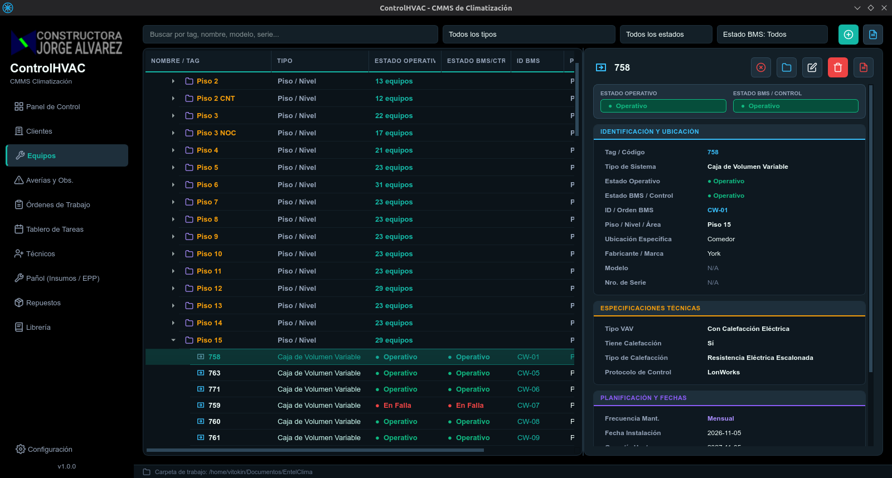

# ControlHVAC — CMMS de Climatización y Gestión de Activos HVAC



**ControlHVAC** es un Sistema de Gestión de Mantenimiento Computarizado (**CMMS**) de escritorio, diseñado específicamente para departamentos de ingeniería, contratos de mantenimiento e instalaciones de climatización (**HVAC / BMS / Electromecánica**). Permite administrar de forma centralizada clientes, instalaciones, activos térmicos, incidencias/averías, órdenes de trabajo preventivas y correctivas, inventario de pañol/herramientas, repuestos y biblioteca documental técnica.

---

## ✨ Características Principales

- **📊 Panel de Control (Dashboard) en Tiempo Real**:
  - KPIs ejecutivos del estado operativo del parque de equipos, estado de integración BMS/Control, alertas de stock crítico y resumen de órdenes e incidencias activas.
- **🏢 Gestión Jerárquica de Clientes, Sitios y Áreas**:
  - Organización multinivel (*Cliente → Instalación/Edificio → Piso/Área → Equipo*) con filtros rápidos y buscador inteligente.
- **❄️ Catálogo Especializado de Equipos HVAC (18 Tipos de Sistemas)**:
  - Soporte nativo con iconografía vectorial dedicada y fichas técnicas parametrizadas con **selectores de unidades de medida** para:
    - **Manejadoras de Aire (`AHU / UMA`)**
    - **Fan Coils (`FCU`)** (incluyendo bomba de condensado y selectores de caudal/potencia)
    - **Cajas de Volumen Variable (`VAV`)**
    - **Equipos Split / Multi-Split** (presentaciones Muro, Cielo, Piso-Cielo, Ducto, Baja Silueta, Cassette, etc. + bomba de condensado)
    - **Compactos de Ducto Condensados por Agua (`WSHP`)**
    - **Equipos `Rooftop`** (capacidad en `Ton`, `BTU/h`, `HP`, `kW`)
    - **Enfriadores de Líquido (`Chillers` Aire/Agua)**
    - **Torres de Enfriamiento (`Cooling Towers`)** (intercambiador de láminas/film, llenado de piscina, drenaje y purga)
    - **Bombas Centrífugas e Hidrónicas (`Pumps`)**
    - **Estanques de Expansión (`Expansion Tanks`)**
    - **Sistemas de Tratamiento de Agua**
    - **Sistemas `VRV / VRF` (Unidades Exteriores, Unidades Interiores y Cajas `HR / BS` Heat Recovery)**
    - **Ventiladores de Extracción / Inyección / Presurización (`Fans`)**
    - **Gabinetes y Tableros Eléctricos (`Electrical Cabinets`)**
    - **Inversores / Variadores de Frecuencia (`VFD / VDF`)**
    - **Termos Eléctricos de Agua (`Electric Water Heaters`)** (monofásicos/trifásicos, ánodo de sacrificio, válvula de alivio/sobrepresión, resistencias)
- **⚠️ Gestión de Averías, Observaciones e Incidencias**:
  - Registro detallado de fallas con severidad, evidencias fotográficas, notas de seguimiento cronológicas, costos de reparación y exportación de reportes técnicos en **PDF** y **Excel/CSV**.
- **📋 Órdenes de Trabajo (`OTM` Preventivas y `OTS` Correctivas)**:
  - Checklists dinámicos por tipo de equipo, asignación de técnicos, consumo automático de repuestos e insumos y generación de guías de servicio en PDF.
- **🗓️ Tablero de Tareas y Planificación**:
  - Vista de programación y seguimiento de mantenimientos periódicos.
- **🧰 Pañol (Insumos, EPP y Herramientas) + 📦 Repuestos**:
  - Control de existencias, alertas de stock mínimo, movimientos de entrada/salida, préstamos y asignación de herramientas a técnicos.
- **📚 Librería Técnica Documental**:
  - Repositorio de manuales, planos, diagramas eléctricos y hojas de datos con apertura directa del archivo o su carpeta contenedora.
- **🎨 Interfaz Moderna y Sistema de Temas**:
  - Diseño oscuro de alto contraste con acentos semánticos, tarjetas modernas y listas desplegables 100% personalizables desde el panel de **Configuración**.

---

## 🛠️ Requisitos del Sistema

- **Python**: `3.10` o superior
- **Sistema Operativo**: Linux, Windows 10/11 o macOS
- **Dependencias principales** (instaladas automáticamente en el entorno virtual):
  - `PySide6 >= 6.7.0` (`Qt6` para Python)
  - `Pillow >= 10.0.0`
  - `openpyxl >= 3.1.0`
  - `fpdf2 >= 2.7.0`

---

## 🚀 Instalación y Ejecución

### En Linux / macOS

El proyecto incluye el script automatizado [`run.sh`](./run.sh) que verifica la versión de Python, crea el entorno virtual (`venv`), instala las dependencias necesarias e inicia la aplicación:

```bash
git clone https://github.com/victorse09/controlhvac.git
cd controlhvac
chmod +x run.sh
./run.sh
```

### En Windows

Puedes ejecutar directamente [`run.bat`](./run.bat) haciendo doble clic o desde la terminal:

```bat
git clone https://github.com/victorse09/controlhvac.git
cd controlhvac
run.bat
```

También dispone de instalador gráfico asistido para Windows mediante [`Instalar_ControlHVAC.bat`](./Instalar_ControlHVAC.bat) / [`installer_gui.ps1`](./installer_gui.ps1).

### Ejecución Manual con Python

```bash
python3 -m venv venv
source venv/bin/activate  # En Windows: venv\Scripts\activate
pip install -r requirements.txt
python -m src.main
```

---

## 📁 Estructura del Proyecto

```text
ControlHVAC/
├── assets/                  # Íconos SVG de navegación, estados y tipos de equipos HVAC
├── src/
│   ├── app/                 # Gestión de estado, configuración y temas visuales
│   ├── core/
│   │   ├── models/          # Modelos de dominio (Equipos, OT, Averías, Inventario, Librería)
│   │   └── services/        # Lógica de negocio, listas personalizables y generación de PDFs/Excel
│   ├── data/                # Motor de persistencia JSON con respaldos automáticos
│   ├── ui/
│   │   ├── components/      # Widgets reutilizables y tarjetas UI
│   │   ├── dialogs/         # Ventanas emergentes modernas (Equipos, OT, Averías, Pañol, Librería, Config)
│   │   └── views/           # Vistas principales de cada módulo
│   └── main.py              # Punto de entrada de la aplicación
├── screenshot.png           # Captura de pantalla principal de la aplicación
├── requirements.txt         # Dependencias de Python
├── run.sh                   # Lanzador automático para Linux/macOS
└── run.bat                  # Lanzador automático para Windows
```

---

## 👤 Autor

- **Victor** (`victorse09@gmail.com`) — [github.com/victorse09](https://github.com/victorse09)
